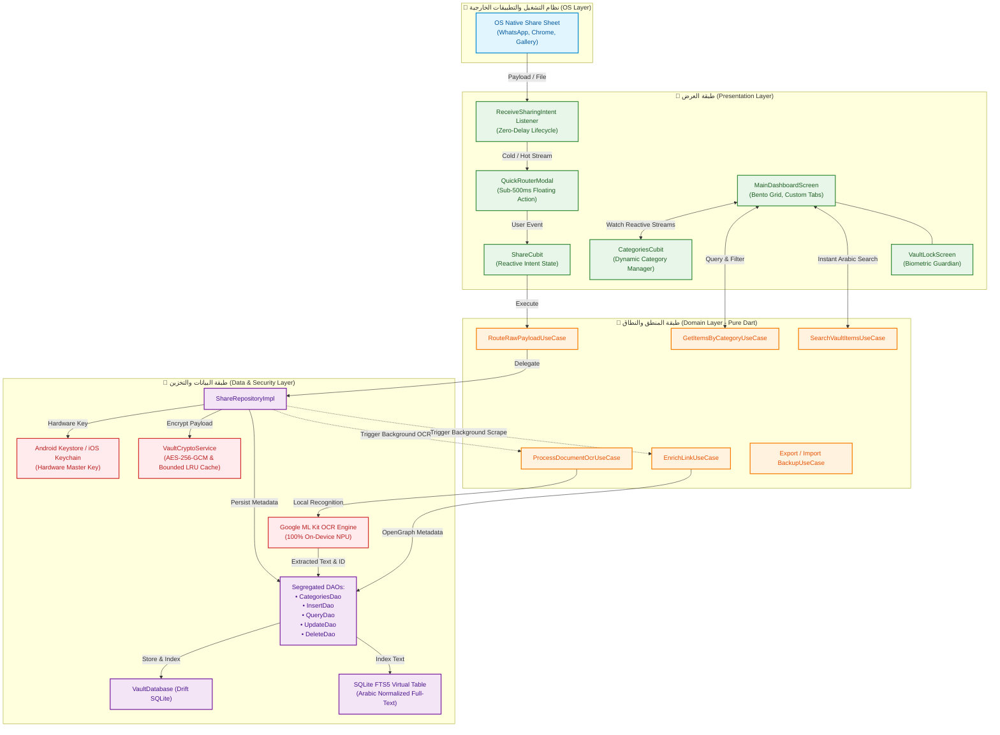

<p align="center">
  
</p>

<h1 align="center">⚓ MARSA (مَرسى)</h1>

<p align="center">
  <strong>Capture. Route. Keep. — مش مجرد شير، مَرسى لكل اللي يهمك</strong>
</p>

<p align="center">
  <em>A high-performance, local-first content interception, OCR intelligence, and encrypted vault engine built for mobile.</em>
</p>

<p align="center">
  <!-- Shields / Badges -->
  <a href="https://flutter.dev"></a>
  <a href="https://bloclibrary.dev"></a>
  <a href="https://drift.simonbinder.eu"></a>
  <a href="#"></a>
  <a href="#"></a>
  <a href="#"></a>
  <a href="#"></a>
</p>

---

## 📑 جدول المحتويات (Table of Contents)

1. [المقدمة والمشكلة الأساسية (Overview & The Problem)](#-المقدمة-والمشكلة-الأساسية-overview--the-problem)
2. [استعراض الفيديو الحي (Video Showcase & Live Demo)](#-استعراض-الفيديو-الحي-video-showcase--live-demo)
3. [الميزات الجوهرية بالتفصيل (Core Features Deep Dive)](#-الميزات-الجوهرية-بالتفصيل-core-features-deep-dive)
   - [محرك الالتقاط السريع (Sub-500ms Quick Router)](#1-محرك-الالتقاط-السريع-sub-500ms-quick-router)
   - [الخزائن الديناميكية ومحرك التصنيفات (Dynamic Vaults Engine)](#2-الخزائن-الديناميكية-ومحرك-التصنيفات-dynamic-vaults-engine)
   - [الذكاء الاصطناعي المحلي وقارئ البطاقة المصرية (On-Device OCR & National ID Parser)](#3-الذكاء-الاصطناعي-المحلي-وقارئ-البطاقة-المصرية-on-device-ocr--national-id-parser)
   - [محرك البحث العربي الذكي (Hybrid Arabic-Aware FTS5 Search)](#4-محرك-البحث-العربي-الذكي-hybrid-arabic-aware-fts5-search)
   - [الأمان العسكري والتشفير العتادي (Bank-Grade Security & Hardware Encryption)](#5-الأمان-العسكري-والتشفير-العتادي-bank-grade-security--hardware-encryption)
   - [النسخ الاحتياطي المشفر والمحمول (Encrypted Portable Backup .marsa)](#6-النسخ-الاحتياطي-المشفر-والمحمول-encrypted-portable-backup-marsa)
   - [التصميم البصري وتجربة المستخدم (Aesthetic & Tactile UX)](#7-التصميم-البصري-وتجربة-المستخدم-aesthetic--tactile-ux)
4. [البنية الهندسية والآركيتيكتشر (System Architecture & Engineering)](#-البنية-الهندسية-والآركيتيكتشر-system-architecture--engineering)
   - [مخطط تدفق البيانات (Mermaid Data Flow Diagram)](#مخطط-تدفق-البيانات-data-flow-diagram)
   - [مبادئ التصميم النظيف (Clean Architecture & Segregated DAOs)](#مبادئ-التصميم-النظيف-clean-architecture--segregated-daos)
   - [إدارة البيئات (Multi-Flavoring Architecture)](#إدارة-البيئات-multi-flavoring-architecture)
5. [هيكل المشروع (Directory Structure)](#-هيكل-المشروع-directory-structure)
6. [حزمة التقنيات والمكتبات (Technology Stack)](#-حزمة-التقنيات-والمكتبات-technology-stack)
7. [دليل التشغيل السريع (Getting Started & Setup)](#-دليل-التشغيل-السريع-getting-started--setup)
8. [الجودة ومؤشرات الاختبارات (Testing & Quality Assurance)](#-الجودة-ومؤشرات-الاختبارات-testing--quality-assurance)
9. [استوديو إنتاج الفيديو البرمجي (Autonomous Video Production Studio)](#-استوديو-إنتاج-الفيديو-البرمجي-autonomous-video-production-studio)
10. [الترخيص وفريق العمل (License & Team)](#-الترخيص-وفريق-العمل-license--team)

---

## 🎯 المقدمة والمشكلة الأساسية (Overview & The Problem)

### المشكلة: مقبرة "الرسائل المحفوظة" (The Self-Chat Graveyard)
ملايين المستخدمين يومياً يشاركون الروابط، الصور، المستندات الرسمية، البطاقات الشخصية، والأفكار مع أنفسهم عبر تطبيقات المراسلة (مثل **WhatsApp "Message Yourself"** أو **Telegram Saved Messages**). النتيجة الحتمية دائماً هي:
- **فوضى عارمة:** خليط غير منظم يضيع فيه العاجل مع المؤجل.
- **انعدام البحث الحقيقي:** صعوبة العثور على صورة بطاقة أو مقال تم حفظه منذ أشهر.
- **انتهاك الخصوصية وتسريب البيانات:** رفع مستندات شخصية حساسة إلى سحابة غير مشفرة عتادياً.
- **روابط ملوثة:** مشاركة روابط تحتوي على معلمات تتبع إعلانية ضخمة (`utm_source`, `fbclid`, etc.).

### الحل: تطبيق «مَرسى» (The MARSA Solution)
**MARSA** ليس مجرد تطبيق حفظ ملاحظات، بل هو **محرك اعتراض وتوجيه فوري (Local-First Content Interception Engine)** يعمل في قلب نظام التشغيل (OS Share Sheet):
- ⚡ **التقاط واعتراض في أقل من 500ms** فور الضغط على زر المشاركة من أي تطبيق دون فتح التطبيق بالكامل.
- 🔒 **100% محلي وخاص (Local-First):** لا توجد خوادم سحابية تجمع بياناتك؛ كل شيء يتم معالجته وتشفيره على المعالج المحلي لجهازك.
- 🧠 **ذكاء اصطناعي مدمج بدون إنترنت:** قراءة النصوص والوثائق العربية والإنجليزية وفك تشفير الأرقام القومية المصرية فورياً.
- 🛡️ **تشفير عتادي عسكري (AES-256-GCM):** حماية المستندات بمفاتيح مشفرة داخل Android Keystore و iOS Keychain مع قفل بيومتري فوري.

---

## 🎬 استعراض الفيديو الحي (Video Showcase & Live Demo)

تم تسجيل استعراض حي وتفصيلي كامل يوضح تدفق العمل الفعلي للتطبيق، سرعة استجابة المودال، الذكاء الاصطناعي في التعرف على البطاقات، البحث العربي اللحظي، والقفل البيومتري.

### 📍 مسار ملف الفيديو في المشروع:
- **المسار الكامل (Absolute Path):**  
  `C:\Users\kerilous\StudioProjects\marsa\video_production\Recording 2026-11-13 001812.mp4`
- **المسار النسبي (Relative Workspace Link):**  
  [`video_production/Recording 2026-11-13 001812.mp4`](video_production/Recording%202026-11-13%20001812.mp4)

> [!TIP]
> **مشاهدة الفيديو مباشرة:**  
> يمكنك النقر على الرابط أعلاه لتشغيل الفيديو داخل مشغل النظام، أو عرضه عبر وسم HTML5 التالي في أي مستعرض يدعم الوسائط المحلية:

```html
<video width="100%" height="auto" controls poster="assets/images/Logo.png">
  <source src="video_production/Recording 2026-11-13 001812.mp4" type="video/mp4">
  Your browser does not support the video tag.
</video>
```

### ⏱️ جدول مراحل الاستعراض في الفيديو (Video Highlights Breakdown):

| الدقيقة / المرحلة | الميزة المعروضة | ما يتم إثباته هندسياً |
|:---|:---|:---|
| **00:00 - 00:20** | **الالتقاط الفوري (Share Sheet Hook)** | اعتراض الشير شيت من متصفح خارجي وظهور الـ Quick Router في أقل من 400ms دون وميض الشاشة. |
| **00:21 - 00:45** | **تنظيف الروابط واستخراج الميتا** | تنظيف الروابط من وسوم التتبع (`utm_`, `fbclid`) واستخراج صورة وعنوان المقال تلقائياً عبر `OpenGraphScraperService`. |
| **00:46 - 01:15** | **المسح الذكي للبطاقة الشخصية (OCR)** | تصوير وقراءة بطاقة رقم قومي مصري محلياً 100% واستخراج تاريخ الميلاد والمحافظة والنوع وحفظها في الخزينة. |
| **01:16 - 01:40** | **البحث اللحظي العربي (FTS5 Search)** | كتابة كلمات بحث عربية بدون تشكيل وبالهمزات المختلفة وإظهار النتائج فوراً بفضل `ArabicTextNormalizer`. |
| **01:41 - 02:05** | **الحماية البيومترية وقفل التطبيق** | تفعيل القفل بالبصمة، خروج التطبيق للخلفية، وقفله فورياً بمجرد العودة لحماية الخصوصية. |
| **02:06 - النهاية** | **النسخ الاحتياطي المشفر (.marsa)** | تصدير الخزينة بالكامل في ملف أرشيف مشفر بكلمة سر وتوليد مفتاح PBKDF2 وحفظه بأمان. |

---

## 🚀 الميزات الجوهرية بالتفصيل (Core Features Deep Dive)

### 1. محرك الالتقاط السريع (Sub-500ms Quick Router)
- **اعتراض نظامي بدون تأخير:** بمجرد مشاركة أي نص، صورة، ملف PDF، أو رابط من أي تطبيق على هاتفك، يلتقط MARSA الحدث عبر `ReceiveSharingIntent`.
- **مودال عائم وخفيف (Floating Bottom Sheet):** تم تصميمه بهندسة تمنع وميض الشاشة (Visual Flash Prevention) وتسمح للمستخدم بتحديد وجهة العنصر بنقرة واحدة، أو تركه يذهب تلقائياً للمخزن المؤقت.
- **منظف الروابط (Payload Sanitizer):** تجريد الروابط فورياً من معلمات التتبع الإعلاني المزعجة لحماية الخصوصية وتوفير مساحة التخزين.

```dart
// مثال على تنظيف الروابط البرمجي في MARSA
final cleanUrl = PayloadSanitizer.sanitizeUrl(rawUrl);
// https://example.com/article?utm_source=twitter&utm_medium=social -> https://example.com/article
```

---

### 2. الخزائن الديناميكية ومحرك التصنيفات (Dynamic Vaults Engine)
ينظم MARSA المحتوى في أربع خزائن رئيسية مهيأة مسبقاً، مع إمكانية إنشاء وتخصيص خزائن جديدة بحرية تامة:

```
┌────────────────────────────────────────────────────────────────────────┐
│                          MARSA DYNAMIC VAULTS                          │
├──────────────────┬──────────────────┬──────────────────┬───────────────┤
│  📄 ورق رسمي     │  🔗 للقراءة      │  📝 ملاحظات      │  ⏳ مخزن مؤقت │
│  (Official Docs) │  (Read Later)    │  (Quick Notes)   │  (Temp Vault) │
│  ─────────────── │  ─────────────── │  ─────────────── │  ──────────── │
│  • OCR محلي      │  • كشط OpenGraph │  • نصوص سريعة    │  • حذف تلقائي │
│  • محلل الرقم    │  • معاينة غنية   │  • حسابات وبنود  │    بعد 72     │
│    القومي المصري │  • قراءة دون نت  │  • بحث فوري      │    ساعة       │
└──────────────────┴──────────────────┴──────────────────┴───────────────┘
```

- **📄 ورق رسمي (`docs`):** مخصص للمستندات والبطاقات الشخصية وجوازات السفر. يفعّل تلقائياً مسار الـ OCR المحلي.
- **🔗 للقراءة والمشاهدة (`readLater`):** مخصص للروابط والمقالات والفيديوهات. يستخرج الميتا داتا وصور المعاينة محلياً.
- **📝 ملاحظات وأفكار (`quickNotes`):** للملاحظات السريعة، النصوص المنسوخة، وأرقام الحسابات البنكية مع تشفير كامل.
- **⏳ مخزن مؤقت (`tempVault`):** مخصص للأشياء المؤقتة (تذاكر ركوب، أكواد OTP، لقطات شاشة مؤقتة). يتمتع بخاصية **الحذف التلقائي الذكي (Auto-Purge TTL)** بعد 72 ساعة لمنع تراكم الملفات المؤقتة.
- **🗂️ محرك الخزائن المخصصة (Dynamic Categories):**
  - جدول SQLite مرن (`VaultCategoriesTable`) يدعم إضافة فئات غير محدودة.
  - منتقي ألوان متناسق مع النظام (Color Palette).
  - حزمة أيقونات منتقاة بدقة (`CategoryIconHelper`).
  - إعادة ترتيب بالسحب والإفلات (`ReorderableListView`).
  - حماية الفئات الأساسية للنظام من الحذف العرضي.

---

### 3. الذكاء الاصطناعي المحلي وقارئ البطاقة المصرية (On-Device OCR & National ID Parser)
- **100% محلي عبر Google ML Kit:** لا يتم إرسال أي صورة لأي خادم خارجي. المعالجة تتم على مسرعات العتاد المحلي (NPU / GPU).
- **محلل الرقم القومي المصري الرياضي (`NationalIdParser`):**
  خوارزمية ذكية تحلل الـ 14 رقماً للبطاقة القومية المصرية وتستخرج البيانات بدقة متناهية:
  - **القرن وسنة الميلاد:** التمييز بين مواليد القرن العشرين والحادي والعشرين بدقة.
  - **تاريخ الميلاد بالكامل:** (اليوم / الشهر / السنة).
  - **محافظة الإصدار:** فك تشفير كود المحافظة لـ 27 محافظة مصرية (القاهرة، الجيزة، الإسكندرية، أسيوط، إلخ).
  - **النوع (ذكر / أنثى):** استناداً إلى الرقم التسلسلي قبل الأخير.
  - **التحقق من صحة الرقم (Checksum Validation):** فحص سلامة التركيب الرقمي.

```dart
// تجربة فك تشفير بطاقة مصرية برمجياً في التطبيق
final result = NationalIdParser.parse('29805140102345');
// Output:
// - Date of Birth: 14 May 1998
// - Governorate: Cairo (القاهرة)
// - Gender: Female (أنثى)
// - Valid: true
```

---

### 4. محرك البحث العربي الذكي (Hybrid Arabic-Aware FTS5 Search)
من أكبر المشاكل في تطبيقات الملاحظات العادية هي فشل البحث في اللغة العربية بسبب اختلاف كتابة الهمزات والتاء المربوطة والتشكيل. يتغلب MARSA على ذلك عبر:
- **جدول بحث كامل النصوص (SQLite FTS5 Full-Text Search):** سرعة استرجاع النتائج في أجزاء من الميلي ثانية حتى مع آلاف العناصر.
- **مُطَبِّع النصوص العربية الذكي (`ArabicTextNormalizer`):**
  - إزالة التشكيل وحركات الإعراب (الفتحة، الضمة، الكسرة، التنوين، السكون، الشدة).
  - توحيد أشكال الألف (`أ`، `إ`، `آ` -> `ا`).
  - توحيد التاء المربوطة والهاء (`ة` -> `ه`).
  - توحيد الياء والألف المقصورة (`ى` -> `ي`).
- **بحث هجين شامل (Hybrid Multi-Field):** يبحث في العنوان، المحتوى، الملاحظات الإضافية، والكلمات المستخرجة من المستندات عبر الـ OCR!

---

### 5. الأمان العسكري والتشفير العتادي (Bank-Grade Security & Hardware Encryption)
صُمم التطبيق ليكون حصناً منيعاً للبيانات الشخصية:
- **تشفير عتادي مصادق (AES-256-GCM):** كل صورة أو مستند يتم حفظه في الخزينة يُشفر فورياً على القرص بامتداد `.enc`. لا يمكن فتح الملف من أي متصفح ملفات خارجي.
- **مفاتيح رئيسية محمية بالعتاد (Hardware Keystore):** المفتاح الرئيسي (`masterKey`) يُولّد ويُحفظ داخل `Android Keystore` أو `iOS Keychain` عبر `flutter_secure_storage`.
- **منع تسريب الذاكرة (Bounded LRU RAM Cache):** لتوفير سلاسة فائقة أثناء التمرير بمعدل 120Hz دون فك التشفير في كل إطار، يتم الاحتفاظ بنسخ مؤقتة في ذاكرة الوصول العشوائي (RAM) المحدودة بحجم 32 عنصراً ومسحها فوراً عند إغلاق التطبيق.
- **حماية بيومترية تلقائية (Biometric Auto-Lock):**
  - دعم التعرف على الوجه (Face ID)، بصمة الإصبع (Fingerprint)، أو رمز PIN للجهاز.
  - مراقبة دورة حياة التطبيق (`AppLifecycleObserver`): بمجرد انتقال التطبيق للخلفية، يُقفل فوراً لحماية الشاشة من التطفل.

---

### 6. النسخ الاحتياطي المشفر والمحمول (Encrypted Portable Backup `.marsa`)
- **ملف أرشيف مشفر محمول (`.marsa`):** يمكنك تصدير بياناتك بالكامل ونقلها لأي جهاز آخر بأمان تام.
- **اشتقاق المفاتيح عبر PBKDF2 بـ 100,000 دورة:** حماية كاملة ضد هجمات القوة الغاشمة (Brute Force).
- **معالجة في مسار منعزل (Dart Background Isolate):** عمليات التشفير وفك الضغط الثقيلة تعمل عبر دالة `compute`، مما يضمن بقاء واجهة المستخدم سلسة تماماً بمعدل 60 إطار في الثانية دون أي تعليق (Jank-Free).
- **حماية SQLite عبر نقطة تفتيش الـ WAL:** تنفيذ `PRAGMA wal_checkpoint(TRUNCATE);` قبل التصدير لضمان عدم ضياع أي بيانات مسجلة في سجل الذاكرة المؤقتة.
- **استرجاع ذري آمن (Atomic Transactional Restore):** فك الضغط والتشفير في مجلد مؤقت (Staging)، والتحقق من صحة الملفات قبل اعتماد الاستبدال مع إمكانية التراجع الكامل عند أي خطأ.

---

### 7. التصميم البصري وتجربة المستخدم (Aesthetic & Tactile UX)
- **شعار فيكتور أصيل (`MarsaLogoEmblem`):** مرسوم بالكامل بدوال Bézier عبر كود دارت خالص، ليعطي دقة متناهية بأي حجم دون أي بيكسلة أو حواف بيضاء.
- **بطاقات بينتو الحديثة (Bento-Grid Cards):** زوايا دائرية 20px (Squircles)، وظلال ناعمة ملونة تعكس هوية كل خزينة (Ambient Glow Shadows).
- **خط كايرو الراقي (Cairo Google Font):** تجربة قراءة مريحة تدعم العربية والإنجليزية باتساق تام.
- **ردود فعل لمسية (Tactile Haptic Feedback):** اهتزازات خفيفة ودقيقة (`HapticFeedback.lightImpact`) عند التنقل بين الخزائن، الحفظ، والخيارات.
- **دعم كامل للوضعين الداكن والفاتح (OLED Dark & Crisp Light):** ألوان داكنة مريحة للعين وموفرة للبطارية في شاشات AMOLED.

---

## 🏛️ البنية الهندسية والآركيتيكتشر (System Architecture & Engineering)

تم بناء **MARSA** وفق أعلى معايير هندسة البرمجيات بالاعتماد على:
- **Clean Architecture + Domain-Driven Design (DDD):** فصل صارم بين منطق العمل، وطبقة البيانات، وطبقة العرض.
- **مبدأ المسؤولية الواحدة ومستودعات البيانات المعزولة (Segregated DAOs):** تقسيم عمليات قاعدة البيانات إلى كائنات وصول منفصلة تمنع التداخل البرمجي.
- **نمط إدارة الحالة (BLoC / Cubit):** تدفق أحادي الاتجاه للبيانات (Unidirectional Data Flow) مع حالات غير قابلة للتعديل (`immutable states`) مدعومة بـ `Equatable`.

### مخطط تدفق البيانات (Data Flow Diagram)



---

### مبادئ التصميم النظيف (Clean Architecture & Segregated DAOs)

#### تقسيم كائنات الوصول لقاعدة البيانات (Segregated DAOs):
بدلاً من وجود كلاس ضخم يتولى كافة عمليات قاعدة البيانات، قمنا بتجزئة المسؤوليات وفقاً لمبدأ المسؤولية الواحدة (SRP):
1. **`VaultCategoriesDao`:** مسؤول عن الفئات الديناميكية، إدراج الفئات الأساسية، وإعادة الترتيب.
2. **`VaultInsertDao`:** مسؤول عن إدراج العناصر الجديدة وفهرسة النصوص الأولية.
3. **`VaultQueryDao`:** مسؤول عن استعلامات العرض التفاعلية (`watchItems`) ومحرك الـ FTS5 للبحث العربي.
4. **`VaultUpdateDao`:** مسؤول عن تحديث بيانات العناصر بعد انتهاء المعالجة الخلفية (OCR / OpenGraph).
5. **`VaultDeleteDao`:** مسؤول عن الحذف الآمن، مسح الملفات المشفرة من القرص، وتنفيذ تنظيف المخزن المؤقت (Auto-Purge TTL).

---

### إدارة البيئات (Multi-Flavoring Architecture)
يحتوي المشروع على فصل هندسي كامل بين بيئة التطوير والإنتاج لضمان عدم تداخل قواعد البيانات أثناء الفحص والتطوير:

```
lib/
├── main.dart        # الموجه الافتراضي (Default Dispatcher)
├── main_common.dart  # المنطق المشترك لحقن التبعيات وتهيئة التطبيق
├── main_dev.dart    # بيئة التطوير: AppConfig(Flavor.dev, db: "marsa_vault_dev.db")
└── main_prod.dart   # بيئة الإنتاج: AppConfig(Flavor.prod, db: "marsa_vault.db")
```

---

## 📂 هيكل المشروع (Directory Structure)

```text
marsa/
├── android/                             # إعدادات أندرويد الأصلية وأذونات المشاركة
├── ios/                                 # إعدادات iOS الأصلية وملحقات Share Extension
├── assets/
│   └── images/                          # شعارات التطبيق والأيقونات عالية الدقة
├── demo example/                        # عينات الفيديو التوضيحية
├── video_production/                    # استوديو إنتاج الفيديو البرمجي المتكامل
│   ├── renders/                         # الفيديوهات المخرجة بدقة Full HD و 4K
│   ├── scripts/                         # نصوص التعليق الصوتي العربي والإنجليزي
│   ├── src/                             # محرك الفيديو البرمجي المكتوب بلغة C#
│   ├── subtitles/                       # ملفات الترجمة الزمنية (.srt)
│   ├── Recording 2026-11-13 001812.mp4  # 🌟 فيديو الاستعراض الحي الرئيسي للتطبيق
│   └── render_all.ps1                   # سكريبت الريندر الآلي الشامل
├── lib/
│   ├── main.dart                        # نقطة الدخول الرئيسية
│   ├── main_common.dart                 # نقطة الانطلاق الموحدة وبناء شجرة الـ BLoC
│   ├── main_dev.dart                    # بيئة المطورين المستقلة
│   ├── main_prod.dart                   # بيئة الإنتاج الرسمية
│   ├── app_config.dart                  # المتحكم في Flavor البيئة
│   │
│   ├── core/                            # النواة المشتركة للبنية التحتية
│   │   ├── constants/                   # الثوابت الرقمية، حالات المعالجة، والفئات
│   │   │   ├── processing_status.dart   # حالات المعالجة (idle, pending, completed, failed)
│   │   │   └── vault_types.dart         # تعريفات الخزائن الافتراضية
│   │   ├── database/                    # طبقة قاعدة البيانات المحلية (Drift SQLite)
│   │   │   ├── daos/                    # Segregated DAOs (Categories, Insert, Query, Update, Delete)
│   │   │   ├── tables/                  # تعريف جداول SQLite و FTS5
│   │   │   └── vault_database.dart      # كلاس قاعدة البيانات الموحد وإدارة الهجرة
│   │   ├── localization/                # اللغات والترجمة (العربية والانجليزية مع دعم RTL كامل)
│   │   ├── security/                    # منظومة الأمان والتشفير
│   │   │   ├── biometrics/              # خدمة القفل بالبصمة والوجه ودورة حياة التطبيق
│   │   │   └── encryption/              # تشفير AES-256-GCM، النسخ الاحتياطي المشفر، والـ LRU Cache
│   │   ├── services/                    # الخدمات المساعدة (التخزين، تنظيف الروابط، الإشعارات)
│   │   ├── theme/                       # منظومة الثيمات (Dark OLED / Light)، الألوان، والخطوط
│   │   ├── utils/                       # معالج النصوص العربية ومحلل الرقم القومي المصري
│   │   └── widgets/                     # ويدجتس عامة (شعار الفيكتور، شاشات التأكيد، التصاريح)
│   │
│   ├── features/                        # الميزات المقسمة معمارياً (Feature-First)
│   │   ├── backup/                      # ميزة النسخ الاحتياطي المشفر واستيراده
│   │   ├── categories/                  # محرك إدارة وتخصيص الخزائن الديناميكية
│   │   ├── dashboard/                   # لوحة التحكم، بطاقات بينتو، شريط البحث، والفلترة
│   │   ├── documents/                   # معالجة المستندات، استخراج نصوص OCR، ومعاينة البطاقات
│   │   ├── links/                       # كشط الميتا داتا (OpenGraph) وتوليد المعاينات الغنية
│   │   ├── onboarding/                  # شاشة الترحيب المتحركة، شرح المزايا، وشاشة البداية
│   │   └── share_receiver/              # محرك التقاط الشير شيت ومودال التوجيه فائق السرعة
│   │
│   └── l10n/                            # ملفات التعريب الرسمية (app_ar.arb و app_en.arb)
│
└── test/                                # حزمة الاختبارات الشاملة (93 اختبار نجاح 100%)
```

---

## 🛠️ حزمة التقنيات والمكتبات (Technology Stack)

| المجال | المكتبة / التقنية | الإصدار | الغرض المعماري |
|:---|:---|:---|:---|
| **Core Framework** | [Flutter](https://flutter.dev) | `^3.x` | إطار العمل الأساسي متعدد المنصات (iOS & Android). |
| **Language** | [Dart](https://dart.dev) | `^3.12.x` | لغة برمجة قوية منيعة ضد القيم الفارغة (Null-Safety). |
| **State Management** | [flutter_bloc](https://pub.dev/packages/flutter_bloc) | `^9.1.0` | إدارة الحالات بنمط BLoC / Cubit لضمان قابلية الاختبار والفصل المعماري. |
| **Value Equality** | [equatable](https://pub.dev/packages/equatable) | `^2.0.7` | مقارنة الحالات والكيانات استناداً للقيمة بدلاً من المرجع. |
| **Local Database** | [drift](https://pub.dev/packages/drift) | `^2.23.1` | قاعدة بيانات SQLite مع فحص أخطاء الترجمة ودعم FTS5 للبحث اللحظي. |
| **Native Bindings** | [sqlite3_flutter_libs](https://pub.dev/packages/sqlite3_flutter_libs) | `^0.5.0` | ربط محرك SQLite3 الأصلي بنظامي أندرويد و iOS بأعلى كفاءة. |
| **Cryptography** | [cryptography](https://pub.dev/packages/cryptography) | `^2.7.0` | خوارزميات التشفير العسكري المصادق (AES-256-GCM و PBKDF2). |
| **Hardware KeyStore**| [flutter_secure_storage](https://pub.dev/packages/flutter_secure_storage) | `^9.2.2` | حفظ المفتاح الرئيسي مشفراً في Android Keystore و iOS Keychain. |
| **Biometrics** | [local_auth](https://pub.dev/packages/local_auth) | `^2.3.0` | قفل الخزينة عبر البصمة والوجه ورمز الحماية للنظام. |
| **On-Device OCR** | [google_mlkit_text_recognition](https://pub.dev/packages/google_mlkit_text_recognition) | `^0.14.0` | التعرف الضوئي على النصوص للوثائق والبطاقات محلياً بدون خوادم. |
| **Share Interception**| [receive_sharing_intent](https://pub.dev/packages/receive_sharing_intent) | `^1.8.1` | اعتراض وتوجيه حمولات الشير شيت على مستوى نظام التشغيل. |
| **External Sharing** | [share_plus](https://pub.dev/packages/share_plus) | `^10.1.4` | إعادة مشاركة العناصر والمستندات للتطبيقات الأخرى. |
| **Web Scraping** | [html](https://pub.dev/packages/html) & [http](https://pub.dev/packages/http) | `^0.15.4` | استخراج بيانات ومعاينات OpenGraph للروابط المحفوظة. |
| **Archive & Compression**| [archive](https://pub.dev/packages/archive) | `^3.6.1` | ضغط وتجميع ملفات الخزينة في ملف أرشيف `.marsa`. |
| **Typography & Fonts**| [google_fonts](https://pub.dev/packages/google_fonts) | `^6.2.1` | تحميل وعرض خط كايرو (Cairo) العربي المتميز. |
| **Animations** | [flutter_animate](https://pub.dev/packages/flutter_animate) | `^4.5.2` | التحريكات الدقيقة والتفاعلية للبطاقات والمودال. |
| **Page Indicator** | [smooth_page_indicator](https://pub.dev/packages/smooth_page_indicator) | `^1.2.1` | مؤشرات التنقل السلسة في شاشات التهيئة (Onboarding). |

---

## 🏁 دليل التشغيل السريع (Getting Started & Setup)

### 1. المتطلبات الأساسية (Prerequisites)
- تثبيت [Flutter SDK](https://flutter.dev/docs/get-started/install) (الإصدار 3.24 فما فوق).
- تثبيت بيئة التطوير (Android Studio / VS Code) مع أدوات Android SDK أو Xcode لـ macOS.

### 2. استنساخ المستودع وتثبيت الاعتماديات (Clone & Install)
```bash
# استنساخ المشروع
git clone https://github.com/your-username/marsa.git
cd marsa

# جلب حزم ومكتبات المشروع
flutter pub get
```

### 3. توليد أكواد قاعدة البيانات (Drift Code Generation)
في حال التعديل على جداول SQLite أو الاستعلامات، شغّل أمر التوليد التلقائي:
```bash
dart run build_runner build --delete-conflicting-outputs
```

### 4. تشغيل التطبيق بحسب البيئة (Running Flavors)
```bash
# تشغيل بيئة التطوير (Development Environment)
flutter run -t lib/main_dev.dart

# تشغيل بيئة الإنتاج الرسمية (Production Environment)
flutter run -t lib/main_prod.dart --release
```

---

## 🧪 الجودة ومؤشرات الاختبارات (Testing & Quality Assurance)

يخضع تطبيق **MARSA** لمنظومة اختبارات صارمة تغطي طبقات النطاق (Domain)، البيانات (Data)، والواجهات (Presentation)، بالإضافة إلى فحص الأمان وفك تشفير الهويات:

```bash
# فحص سلامة وتناسق الأكواد البرمجية (Linter Check)
flutter analyze
# Результат: No issues found! (ran in 6.8s)

# تشغيل كافة الاختبارات الوحدوية والتكاملية
flutter test
# Результат: 00:05 +93: All tests passed! (100% Pass Rate)
```

### 📊 جدول إحصائيات الاختبارات (93 Tests Summary):
- **Category Domain & UseCases Tests:** 7 اختبارات (إنشاء، تعديل، حذف، وإعادة ترتيب الفئات).
- **Category Presentation & Cubit Tests:** 4 اختبارات (التفاعل الحي والتحديث الفوري).
- **Biometric Security & Lifecycle Tests:** 7 اختبارات (التحقق بالبصمة والقفل عند تصغير التطبيق).
- **Egyptian National ID Parser Tests:** 12 اختباراً (فك شفرة كافة المحافظات والمواليد والنوع).
- **Arabic Text Normalizer Tests:** 8 اختبارات (إزالة التشكيل وتوحيد الهمزات والألف المقصورة).
- **Vault Database & DAOs Integration Tests:** 32 اختباراً (الإدراج، الحذف التلقائي TTL، والبحث السريع FTS5).
- **Share Receiver & Payload Sanitizer Tests:** 23 اختباراً (تنظيف الروابط، اعتراض النوايا، والمودال السريع).

---

## 🎥 استوديو إنتاج الفيديو البرمجي (Autonomous Video Production Studio)

يحتوي مجلد [`video_production/`](video_production/) على استوديو إنتاج فيديو آلي متكامل مبرمج بلغة C# ونظام Windows Media Foundation:
- **إنتاج 8 فيديوهات عالية الدقة (1080p Full HD & Vertical 4K Reel):** تستعرض ميزات التطبيق، آركيتيكتشر النظام في عرض ثلاثي الأبعاد، وعروض المسابقات.
- **توليد نصوص صوتية وترجمات زمنية متطابقة (.srt):** باللغتين العربية والإنجليزية.
- **ريندر مؤتمت بالكامل:** يمكن إعادة تصدير كافة الفيديوهات بأمر واحد:
```powershell
powershell -ExecutionPolicy Bypass -File .\video_production\render_all.ps1
```

---

## ⚖️ الترخيص وفريق العمل (License & Team)

مشروع **MARSA (مَرسى)** تم تطويره بشغف لتقديم أفضل معايير البرمجة النظيفة وهندسة التطبيقات على الهواتف الذكية.

- **المطور الرئيسي:** Kerilous & MARSA Engineering Team
- **الشعار والهوية:** *Capture. Route. Keep. — مش مجرد شير، مَرسى لكل اللي يهمك*
- **الترخيص:** مرخص تحت رخصة [MIT License](LICENSE).

<p align="center">
  <sub>صُنع بكل فخر واعتزاز كنموذج هندسي عربي استثنائي في عالم تطبيقات الهواتف الذكية 🇪🇬⚓</sub>
</p>

